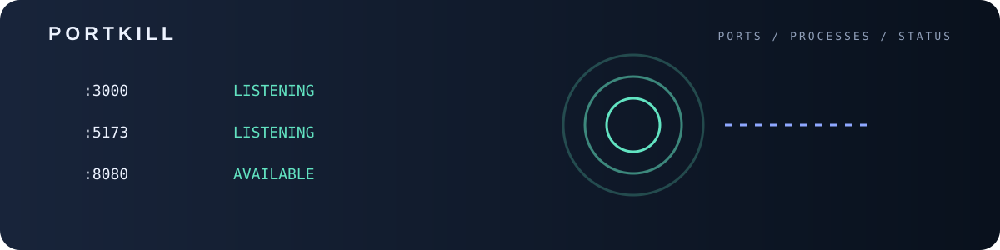

<p align="center">

<p align="center"></p>
  
</p>

<p align="center">
  
  
  
  
</p>

**`Error: listen EADDRINUSE: address already in use :::3000`** - we have all been there.
`portkill` shows what is holding a port and frees it with one short command. No `lsof | grep | awk | xargs kill` incantations.

## Features

- Lists every TCP listener: port, PID, bind address and process name
- Frees one or many ports at once: `portkill 3000 8080`
- Graceful stop first, `--force` when a process refuses to die
- Asks before stopping anything (skip with `-y`)
- `--dry-run` to preview, `--json` for scripts
- Works on Linux (`ss`), macOS (`lsof`) and Windows (`netstat`/`taskkill`)
- Single file, standard library only

## Install

```bash
pip install git+https://github.com/ERROR404DTIR/portkill.git
```

Or just grab the single file:

```bash
curl -O https://raw.githubusercontent.com/ERROR404DTIR/portkill/main/portkill.py
python3 portkill.py
```

## Usage

```text
$ portkill
PORT   PID      ADDRESS           PROCESS
3000   4821     *                 node
8080   5190     127.0.0.1         python3

$ portkill 3000
PORT   PID      ADDRESS           PROCESS
3000   4821     *                 node

Stop these processes? [y/N] y
 freed port 3000 (node, pid 4821)
```

| Command | What it does |
| --- | --- |
| `portkill` | List all listening TCP ports |
| `portkill 3000` | Stop whatever owns port 3000 (asks first) |
| `portkill 3000 8080 -y` | Free several ports without a prompt |
| `portkill 5173 --force` | SIGKILL / `taskkill /F` a stubborn process |
| `portkill 3000 --dry-run` | Show what would be stopped |
| `portkill --json` | Machine-readable listener list |

### Exit codes

| Code | Meaning |
| --- | --- |
| `0` | Success |
| `1` | Port not found, aborted, or a process could not be stopped |
| `2` | Refused to run non-interactively without `-y` |

## Notes

- Processes owned by other users need `sudo` (or an administrator shell on Windows); `portkill` tells you when the owner is hidden.
- On Windows, only IPv4 TCP listeners are listed (limitation of `netstat -p TCP`).
- `portkill` never stops itself and never touches anything you did not name.

## License

MIT